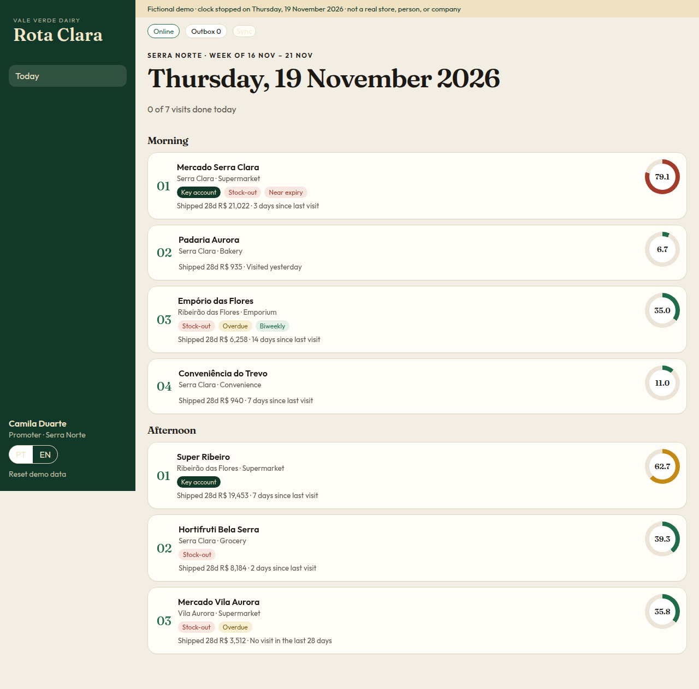
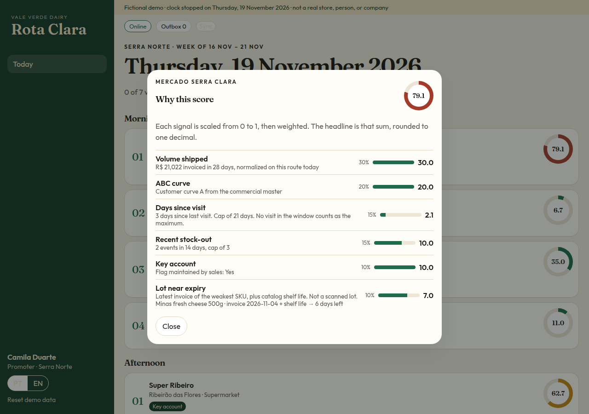
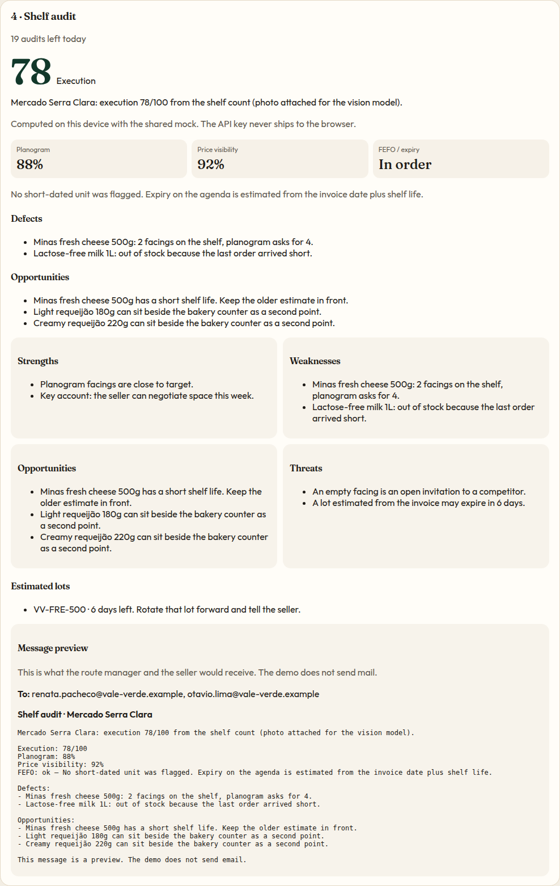
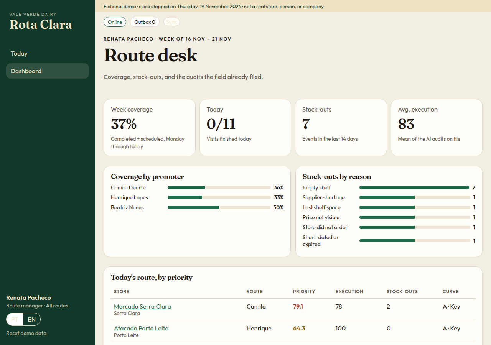
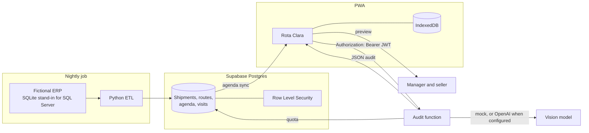
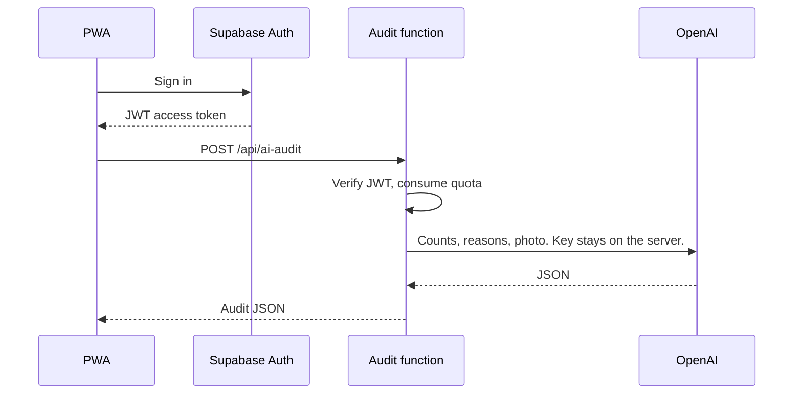

# Rota Clara

[](https://github.com/Zelezim/field-promoter-app/actions/workflows/ci.yml)


**All data in this repository is fictional.** Rota Clara is a sanitized public showcase of a real field-execution system used by promoters at a Brazilian dairy company. It does not name that company, its stores, its people, its network, or its ERP. Vale Verde Dairy, the promoters, the stores, and the SKUs were invented for this portfolio.

Rota Clara turns last night's shipments into this morning's visit agenda. A promoter already walks a fixed weekly route; the job does not redraw the route. It scores every stop so the promoter knows where the shelf needs attention: what shipped, who is a key account, who has not been seen, where product was missing, and which lot — estimated from the invoice date plus shelf life — is about to expire. At the store they check in, count the shelf, log a stock-out with a standard reason, photograph the gondola, and get a structured audit back. The route manager sees coverage, stock-outs, and those audits on one desk.

The static demo runs with zero setup. The SQL, the audit function, and the Python ETL are the real shape of the system, with the model key kept on the server and a mock standing in until a key is configured.

## Screenshots

The interface is Portuguese by default, with an English toggle. These frames are from the English demo clock (Thursday, 19 November 2026).









Also in `docs/screenshots/`: the login (`login.png`), the same agenda in Portuguese (`agenda-pt.png`), the visit with GPS check-in and shelf counts (`visit.png`), and a phone-width agenda (`agenda-mobile.png`).

## Features

- Fixed weekly route (weekday, morning/afternoon, stop order, weekly or biweekly) with a priority score on every stop.
- Nightly ETL: invoice header → items → product catalog → customer and seller, then the agenda.
- GPS check-in. The demo can simulate arrival, because the addresses are not real.
- Shelf count per SKU, stock-outs with a shared reason list, before/after photos.
- AI shelf audit as JSON: execution score, defects, opportunities, SWOT, planogram, price visibility, FEFO. A preview of the email to the route manager and the seller. The demo does not send mail.
- Offline-first installable PWA. The agenda, the counts, and the mock audit live in IndexedDB. After the first load the demo works offline.
- Manager desk: week coverage, today's visits, stock-outs by reason, store ranking, AI reports.
- Same audit module in the browser and in the server function. The server checks a Supabase JWT and a per-user quota before any model call.

## Architecture





In the static demo there is no Supabase project. The client sends `Authorization: Bearer demo.<userId>`. On Netlify the function accepts that token only while `AI_PROVIDER` is not `openai` and `ALLOW_DEMO_TOKENS` is not `false`. On GitHub Pages the function is absent, the request fails, and the PWA runs the same mock locally.

## Stack

| In this repo | Role |
| --- | --- |
| Vite PWA | Installable offline demo, static build |
| IndexedDB | Agenda, counts, photos, audits on the device |
| Netlify Function | `POST /api/ai-audit` |
| Supabase Auth + Postgres | JWT, RLS, quota table |
| Python 3.12 | Nightly ETL and the priority score |
| SQLite | Offline stand-in for the ERP and the warehouse |
| Docker | Image that runs the nightly job against the fixture |
| GitHub Actions | Lint, test, build |

Day to day the author also works with FastAPI, SQL Server, Power BI, Qlik, and Go/HTMX. The audit contract here is the same one a FastAPI route would serve. The ETL comments assume SQL Server as the source and Postgres as the target; tests never open either.

## Data model

| Table | What it holds |
| --- | --- |
| `promoters`, `sellers`, `profiles` | Field user, seller, and the Supabase Auth link. New accounts start as promoters. |
| `stores`, `products` | Customer master (ABC curve, key account) and the SKU catalog (shelf life, planogram facings). |
| `routes` | Fixed route: weekday, shift, order, weekly or biweekly, week parity. |
| `shipments`, `shipment_lines` | Invoices loaded by the nightly job. `estimated_expiry` is invoice date + shelf life. |
| `agenda_stops` | One row per planned visit, with the score and the six components. |
| `visits`, `stock_counts`, `stockouts`, `visit_photos` | What the promoter did in the store. |
| `ai_audits` | The JSON audit. Inserts are service-role only. |
| `ai_usage` | Per-user, per-day call count. |

`supabase/migrations/20261119000000_init.sql` is the full DDL, the helper functions, and the policies.

## How the agenda score works

The route order does not change. The score says where to spend the hour if the day runs long. Each signal is scaled from 0 to 1. The weights sum to 1. The headline is the weighted sum times 100, rounded to one decimal, half away from zero (the same rounding in JavaScript and Python).

| Weight | Signal | How it is scaled |
| --- | --- | --- |
| 0.30 | Volume shipped | Invoiced value over the 28 days before the visit, min–max across that promoter's stops that day |
| 0.20 | ABC curve | Customer curve from the commercial master: A = 1, B = 0.6, C = 0.3 |
| 0.15 | Days since last visit | Days / 21, capped at 1. No completed visit in the window = 1 |
| 0.15 | Recent stock-out | Events in the 14 days before the visit / 3, capped at 1 |
| 0.10 | Key account | 1 or 0 |
| 0.10 | Lot near expiry | Latest invoice of each SKU, plus catalog shelf life. The soonest SKU: `(20 - days left) / 20`, capped at 0 and 1 |

The job runs the night before, so invoices, visits, and stock-outs dated on the visit day itself are not in the score. Expiry is an estimate, not a scanned lot.

On Camila Duarte's Thursday route the spread is intentional: Mercado Serra Clara is a key account with a recent stock-out and a frescal lot about six days out (about 79). Padaria Aurora was visited yesterday and ships very little (about 7). Mercado Vila Aurora has not been seen in the window.

A biweekly stop runs when `ISO week % 2` equals the route's `weekParity`. Empório das Flores is on the demo Thursday because 19 Nov 2026 is ISO week 47.

## AI audit JSON

`POST /api/ai-audit` with `Authorization: Bearer <jwt>` and a body of `storeId`, `counts`, `stockouts`, an optional `photoDataUrl`, and the lot estimate. The mock (`shared/audit-core.js`) and the OpenAI path return the same shape. The photo is attached for the vision model; the mock scores the counts and says so.

```json
{
  "source": "mock",
  "model": "mock-rota-clara-v1",
  "storeName": "Mercado Serra Clara",
  "executionScore": 78,
  "planogramCompliance": 0.88,
  "priceVisibility": 0.92,
  "fefo": {
    "compliant": true,
    "notes": "No short-dated unit was flagged. Expiry on the agenda is estimated from the invoice date plus shelf life."
  },
  "defects": [
    {
      "sku": "VV-FRE-500",
      "type": "facing",
      "severity": "medium",
      "detail": "Minas fresh cheese 500g: 2 facings on the shelf, planogram asks for 4."
    },
    {
      "sku": "VV-LEZ-1000",
      "type": "stockout",
      "severity": "high",
      "reason": "supplier",
      "detail": "Lactose-free milk 1L: out of stock because the last order arrived short."
    }
  ],
  "opportunities": [
    {
      "sku": "VV-REQ-220",
      "type": "secondary_display",
      "detail": "Creamy requeijão 220g can sit beside the bakery counter as a second point."
    }
  ],
  "swot": {
    "strengths": ["Key account: the seller can negotiate space this week."],
    "weaknesses": ["Lactose-free milk 1L is out of stock."],
    "opportunities": ["Creamy requeijão 220g can sit beside the bakery counter."],
    "threats": ["A lot estimated from the invoice may expire in 6 days."]
  },
  "expiryRisks": [
    {
      "sku": "VV-FRE-500",
      "daysLeft": 6,
      "action": "Rotate that lot forward and tell the seller."
    }
  ],
  "summary": "Mercado Serra Clara: execution 78/100 from the shelf count.",
  "notify": {
    "to": [
      "renata.pacheco@vale-verde.example",
      "otavio.lima@vale-verde.example"
    ],
    "subject": "Shelf audit · Mercado Serra Clara",
    "preview": true
  }
}
```

Set `AI_PROVIDER=openai` and `OPENAI_API_KEY` and the function sends the counts plus the photo to the Chat Completions API (`gpt-4o-mini` by default) with `response_format: json_object`. No key, no call: the function returns 503 rather than silently pretending.

## Security

- The browser never holds the model key. It holds a Supabase access token.
- The function verifies an HS256 JWT with `SUPABASE_JWT_SECRET`. Demo tokens are rejected as soon as the real provider is on, or when `ALLOW_DEMO_TOKENS=false`.
- Quota is `public.consume_ai_quota`, executed with the service role. If that database is not configured, the function uses a process-local counter and does not fall open when the database is configured and errors.
- Row Level Security: a promoter reads and writes their own route and visits; a seller reads their stores, shipments, and audits; a manager reads the team. `ai_audits` has no insert policy for `authenticated` — the function writes it. A new user trigger inserts `role = 'promoter'`; a manager is granted with the service role, not via signup metadata.
- `.env.example` lists every variable. Nothing secret is committed. `.netlify` is gitignored.

## Run it

Demo, no environment variables:

```bash
npm install
npm run dev
```

Open the app and pick Camila Duarte, Henrique Lopes, Beatriz Nunes, or Renata Pacheco. `npm run build` then `npm run preview` serves the production PWA.

```bash
npm test          # priority score, agenda, audit, JWT, quota
npm run lint
pip install -r etl/requirements.txt
pytest            # score, ERP join, transforms, JS/Python parity
python -m vale_verde_etl --date 2026-11-19 --promoter promo_camila
```

Docker, from the repo root:

```bash
docker build -t rota-clara-etl .
docker run --rm rota-clara-etl
```

Netlify: build command `npm run build`, publish `dist`. The function is `netlify/functions/ai-audit.js` at `POST /api/ai-audit`. Add the variables from `.env.example` in the Netlify UI when you leave mock mode.

GitHub Pages (project site): `BASE_PATH=/<repo>/ npm run build` and publish `dist`. The audit then runs on the device, because Pages has no function. That is the same module the function calls.

Apply the database with the Supabase CLI (`supabase db push`) when you have a project. The demo does not need it.

Regenerate the fictional fixture, if you change the generator:

```bash
python scripts/generate_fixture.py
```

CI checks that `shared/fixture.json` still matches the generator.

## Layout

```
src/                     PWA
shared/                  score, agenda, audit, fixture — imported by the PWA and the function
netlify/functions/       POST /api/ai-audit
supabase/migrations/     schema and RLS
etl/vale_verde_etl/      extract, transform, load, score
scripts/                 fixture generator, icons, screenshots
docs/screenshots/        frames from a real run of the built app
```

## Roadmap

- Sync the on-device outbox to Supabase instead of only posting the audit.
- Store photos in Supabase Storage; the table already keeps a `storage_path`.
- Replace the invoice-date expiry estimate with a scanned lot when the ERP has one.
- Ship the same audit contract as a FastAPI service next to the nightly job.
- A Power BI or Qlik model on `agenda_stops`, `stockouts`, and `ai_audits`.

## About the author

Abner Mazur is a Data Analyst and AI Solutions Analyst. He studied Economics and Systems Analysis, and he is AWS and Power BI certified. He works with data and AI in the Brazilian dairy industry — this repository is the public, fictional version of that field-execution work.

[linkedin.com/in/abnermazur](https://www.linkedin.com/in/abnermazur)

## License

[MIT](LICENSE)
